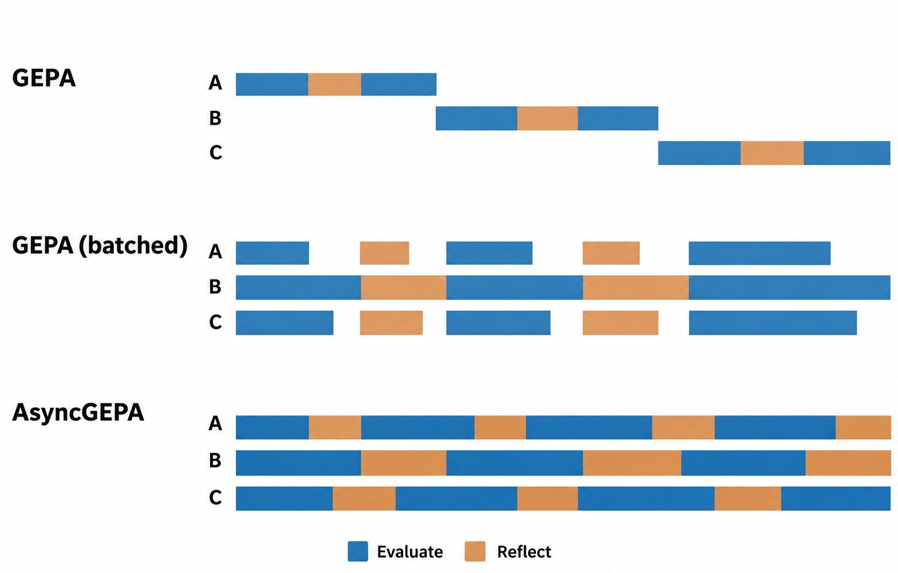

<p align="center">
  
</p>

An experimental fork of [GEPA](https://github.com/gepa-ai/gepa) with continuous asynchronous rollouts.

AsyncGEPA overlaps evaluation and reflection across proposals, helping keep the evaluation model busy while other proposals wait for reflection. It retains GEPA's optimization interfaces and adds a shared queue for individual evaluation requests.

## Installation

```bash
uv pip install async-gepa
```

## Usage

Enable continuous scheduling with an asynchronous evaluation adapter:

```python
from async_gepa import optimize
from async_gepa.strategies.scheduling import ContinuousRollouts

result = optimize(
    seed_candidate=seed_candidate,
    trainset=trainset,
    valset=valset,
    adapter=adapter,
    reflection_lm=reflection_lm,
    max_metric_calls=1_000,
    scheduler=ContinuousRollouts(
        max_in_flight_proposals=8,
        max_in_flight_rollouts=64,
        max_proposal_age=3,
    ),
)

print(result.best_candidate)
```

The adapter implements `async def evaluate(...)`, retaining GEPA's inputs and result format. Omit `scheduler` and use a synchronous adapter for standard GEPA execution.

See the [practical guide](https://github.com/DGoettlich/async-gepa/blob/main/docs/usage.md) for adapting your evaluator, configuring concurrency and using custom strategies.

## How it works



*Conceptual scheduling illustration; not measured timings.*

GEPA advances one proposal at a time. Batched GEPA processes multiple proposals through coordinated stages. AsyncGEPA lets proposals advance independently as their dependencies finish.

All ready evaluation requests enter a **shared FIFO queue**. When a request finishes, another queued request can take the available slot—even if it belongs to a different proposal. Reflection can therefore overlap evaluation, and slow requests do not hold up unrelated work.

Selection still follows the configured strategy: `AllImprovements` can advance individual improvements immediately, while strategies that compare siblings wait for their group.

- **[Practical guide](https://github.com/DGoettlich/async-gepa/blob/main/docs/usage.md):** execution modes, adapters, concurrency and custom strategies.
- **[API reference](https://github.com/DGoettlich/async-gepa/blob/main/docs/api.md):** async classes, their interfaces and changes from GEPA.
- **[Upstream GEPA documentation](https://gepa.dev/):** optimization concepts and unchanged functionality.
